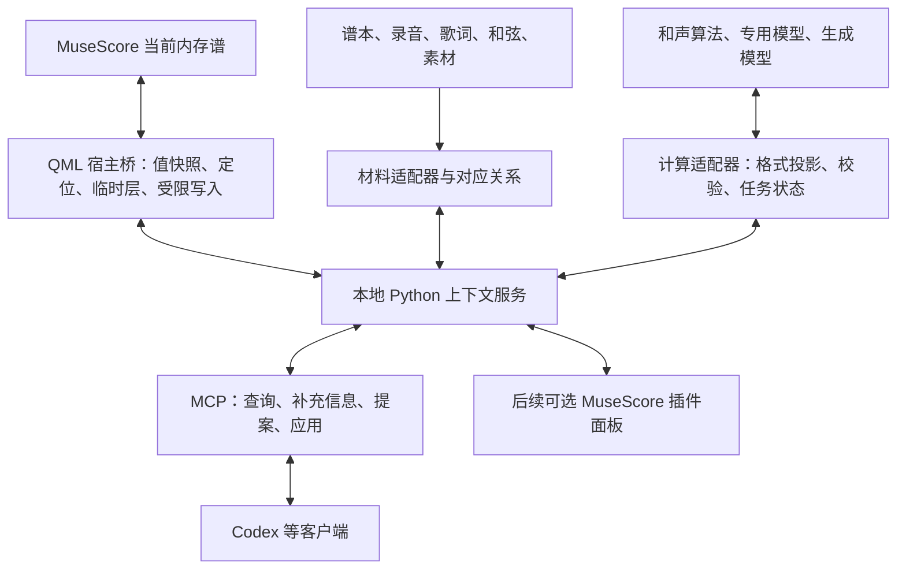

# 可选音乐信息、实时取谱与外部交互契约

日期：2026-10-10。状态：**0.60.0／桥2.2.0已接入当前谱读取、局部候选和原生建议面板。** 当前用法与字段见[P2接口](P2_CONTEXT_API.md)；本文继续记录后续材料与模型适配的设计。

补充 [乐谱数据与 AI 上下文设计](AI_SCORE_CONTEXT_DESIGN.md)。本次把可选解释/原曲关系、实时宿主读取、外部材料/模型适配，以及讨论与回写明确为可独立实施的契约。本文决策优先于旧文中可能产生歧义的概括。

## 1. 本次明确的架构决定

1. **写作主路径直接读取 MuseScore 的当前内存谱。** 不要求保存、不要求先导出 MusicXML，也不借由重导入整谱应用局部建议。
2. **基础乐谱可独立使用。** 原曲、已知和弦、结构解释、歌词对应、手分配、风格目标都是可选信息；不齐全不等于无法分析。
3. **信息的来源、可用程度与采用状态分开。** 用户陈述、算法候选、参考谱事实、原生记谱不能混成一个无来源的字段。
4. **本地上下文服务是共同中枢。** QML 宿主桥、MCP、外部材料和模型各用适配器对接同一服务；MCP 是访问通道，不是数据模型本身。
5. **读、解释交流、提案、临时预览、持久改谱分开。** 用户可以只纠正解释而不改谱，也可以明确授权范围内直接改谱，不必每个音再次确认。

本次两仓库均先 pull，均已同步。读取基线：MCP `2b2d422`，MuseScore `4c04ca711` / personal 0.22.0。和声助手 1.5 已有人工区间、结果交换、临时标记与待排元数据，但这不等于已接入本文通用服务。本轮只改规划与说明，不修改原生源码、桥、skill 或用户乐谱。

## 2. 必选核心与可选信息层

核心需要标明 `schemaVersion / documentId / scoreSessionId / snapshotId / scope / coverage / capabilities`，以及本次任务实际读取到的记谱对象。读取失败或根本没有开谱时返回明确状态，不伪造空谱。

可选层建议组织为独立集合：

```text
scoreSnapshot        当前谱事实与版本
assertions           用户/算法/参考提供的解释、角色、结构等
materials            参考谱、音频、歌词、和弦表、素材片段、文字目标
alignments           当前谱与材料之间的局部对应关系
taskBrief            本次目标、约束与操作授权范围
analysisRuns         算法/模型的运行结果和证据
proposals            创作/修改候选及讨论状态
```

工程中可以保存完整集合，而每次上下文只投影任务需要的部分。`assertions/materials/alignments` 未提供时可为空；同时由块级 coverage 说明这是什么意思。没有原曲时照常分析当前谱，不能自动声称“忠于原作”；没有已确认旋律时可以给候选，也可以先按原生声部讨论。

### 2.1 可选不能只用 null 表示

每个被请求的信息块分别记录可用状态、覆盖范围与处理状态，避免单个枚举混合所有含义：

| 维度 | 提议状态 | 含义 |
| --- | --- | --- |
| availability | `available` | 有信息；可以仅覆盖一部分 |
| availability | `notProvided` | 用户/来源未提供，例如没有原曲资料 |
| availability | `absent` | 在已完整检查的范围内确认不存在，例如本谱没有歌词 |
| availability | `unsupported` | 当前宿主/适配器不能读取该类数据 |
| coverage | `complete / partial / unknown` + scope | 对哪个范围完整；只知道副歌和弦不等于知道整曲 |
| processing | `notRequested / pending / ready / failed` | 未取数、后台计算中或失败，不是“音乐上不存在” |
| freshness | `current / stale / unknown` | 依赖的谱/材料/解释是否仍匹配当前版本 |

协议中状态字段可以按信息块共享，避免每个音附一套状态。自然语言只显示和任务有关的缺口，不向用户倾倒状态表。`[]` 只有结合 coverage 才能解释为完整检查后的“没有”；不读取的字段不许默认为不存在。

例如：原曲歌词 notProvided 不影响本谱和声分析；踏板 unsupported 会限制“原生实际踏板如何影响听感”的结论；谱面歌词 absent 可以作为已核对事实。若任务就是核对原作和弦，缺原作资料才成为该子任务缺口；优先报告已能判断的部分，再请求关键材料。

### 2.2 用户已知内容如何接入

统一记录成 assertion，至少包含：

```text
id / kind / target / value
origin / evidence / createdAgainst
status / selectedForTask / dependencies
```

kind 可为 harmony、tonalRegion、phrase、roleAssignment、handAssignment、formLabel、intention 等；target 是对象或时间范围，可以只覆盖半小节或一个段落。origin 区分 user、nativeNotation、reference、algorithm、model，并带来源版本。

status 可为 proposed、accepted、rejected、superseded。**用户确认的解释是当前任务采用的解释，并不自动成为客观唯一真相。** 对事实性声明另保留核对证据；有歧义的理论解释可以并列。confidence 不是 status，不用模型随口给的 0.9 冒充已校准概率。

用户说“这个主题在左手”，可保存局部角色 assertion；说“这段从 Em 转到 G”，可保存调性路线 assertion；说“我想让这一段有悬念”，属于 taskBrief/intention。后者描述目标，不声称已经达成。

默认保留明确的用户解释供分析参考；算法发现不一致时输出冲突与依据，不能静默覆盖。若用户将解释作为必须遵守的创作约束，另写 `constraints`；“接受某种分析”“喜欢某种风格”“锁定不许改某组音”是三个不同动作。

### 2.3 部分、冲突和过期

- 每个来源可只覆盖部分字段/范围。原曲只给和弦表、没有旋律或录音，仍是有效材料。
- 同一区间的多个和声标签可以并存；taskBrief 选择当前采用的分支，未选择时给候选比较。记谱和弦符号也未必等同每个经过音的瞬时集合。
- 用户解释与原曲材料冲突不必一方必错：当前编曲可能重配和声；保存差异而非自动“纠错”。
- 改谱、改原曲对应或纠正角色时，通过依赖版本使受影响分析/候选过期。无关的参考材料无需失效。
- 源数据覆盖后不抹掉旧来源和评价历史；撤回选择与删除文件分开。本项目不擅自删除文件。

## 3. 原曲与素材的可选关系

### 3.1 材料不是当前谱的一部分

Material 记录 `id/type/identity/source/version/availableFeatures/coverage/provenance`。type 可为 score、recording、chordChart、lyrics、motif、arrangementNote、analysisDataset。题名信息、文件内容、外部链接可分别提供；只有题名时不假装取得了完整作品数据。

“原曲参考”“编曲素材”“练习范例”“风格参照”是使用关系，不由文件扩展名推断。用户提供的一串和弦可能是期望路线，而非原作和弦；需要保留其角色。

歌词分原曲歌词、当前谱已附着的 syllables 和映射关系；删词/重复/改节奏可以导致非一一对应。段落 A/B/C 是来源内的标签，不能因名字相同就当作同一片段。

### 3.2 对应关系也是可选、局部、可修正的

Alignment 明确 from/to 材料与各自坐标系统：当前谱的 snapshot/对象/记谱区间，录音的秒数，参考谱的小节/事件，歌词的行/词/音节。记录 `relationType / transform / provenance / status / coverage / dependencies`。

关系支持引用、对应、移调、删节、重配、重复、改编；允许一对多、多对一和不确定候选。谱面 tick 与录音秒数之间的变换可以分段，反复时每次出现单独映射。不存在对应时不自动按小节号猜测。

示例：已知当前 m17–24 是原曲副歌，且原曲该段和弦为 Em–C–G–D。可以讨论“是否保留原和声”和对比当前低音；没有逐拍对应时不能把四个和弦精确强贴到每个拍点。补齐录音/谱本后再细化 mapping，已有材料不用重建。

### 3.3 最小示例（提议数据，非当前工具返回）

```json
{
  "schemaVersion": "context-integration/0.1",
  "scoreSnapshot": {"id": "snap-42", "scope": {"measures": [17, 24]}},
  "optionalCoverage": {
    "referenceChords": {"availability": "available", "coverage": "partial", "processing": "ready"},
    "referenceLyrics": {"availability": "notProvided", "processing": "notRequested"},
    "confirmedMelody": {"availability": "notProvided", "processing": "notRequested"}
  },
  "materials": [
    {"id": "original-chords", "type": "chordChart", "use": "originalReference",
     "features": {"progression": ["Em", "C", "G", "D"], "section": "chorus"},
     "origin": {"kind": "user"}}
  ],
  "alignments": [
    {"id": "a1", "from": {"snapshotId": "snap-42", "measures": [17, 24]},
     "to": {"materialId": "original-chords", "section": "chorus"},
     "precision": "section", "status": "accepted"}
  ],
  "assertions": [
    {"id": "h1", "kind": "harmony", "target": {"snapshotId": "snap-42", "measure": 17},
     "value": {"symbol": "Em7"}, "origin": {"kind": "user"}, "status": "accepted"}
  ],
  "taskBrief": {"intent": "讨论副歌推进", "interactionMode": "discuss"}
}
```

此例的 Em7 是用户给当前编曲的解释，参考 Em 是原曲材料；差异可解释，不是系统冲突。缺少旋律标注时可提取候选，不要求先让用户填写。删除 materials/alignments 的投影、将 referenceChords 设为 notProvided，当前谱分析仍可运行。

## 4. 怎么暴露：实时宿主桥＋共同服务＋多种入口



插件与 MCP 是两段不同职责，最合理的主链是：**软件内存对象 → QML 桥 → Python 服务 → MCP → agent**。当前代码已经有其中基本传输链，需扩展的是读取契约、上下文模型与交互动作。

### 4.1 写作时直接从宿主读取

读取当前谱、选区和有效状态，范围提取在宿主执行。转成带版本、类型、单位的值快照后交给 Python；不把原生指针传到外部。数据适配器保留提取来源，异步/分页来自同一 snapshot；用户继续写作时旧任务可以显示结果，但标过期，不能静默应用。

区分已保存文件、内存已提交编辑、演奏编辑器未提交预览、当前已渲染播放。首版权威读取内存已提交状态；暂存状态无法读到时显式报告，不默认“保存文件就是现在听到的”。后续用必要的原生只读状态接口补充。

MusicXML 在这条主链上**不是前置步骤，也不是内部唯一格式**。它留给外部交换、参考谱输入，以及只能消费该格式的外部模型。某适配器确需导出时，由适配器产生带来源版本的临时工件，报告个人扩展/拼写/时值等转换损失；不让用户为每次分析手工导出。

当前桥可直接读基础结构；完整标记范围、对象身份、个人演奏属性和所有几何仍需扩展，不把“实时读取更好”误写成“现在所有字段已经能读”。局部写回用原生对象操作，避免重新导入整首 MusicXML 丢掉排版/个人属性/对象对应。

### 4.2 核心服务与入口独立

Python 业务函数使用有类型的 request/response，不依赖 MCP 装饰器。MCP 只是其中一个 facade；未来插件里的聊天/检查器用相同服务请求，不另建一套事实/历史。服务可运行在当前 MCP 进程中，首版不必启动新常驻进程或公开 HTTP 端口。

当前 agent 驱动模式：agent 读任务包、交流、提交候选；若没有独立模型适配器，服务不擅自再调用另一个 LLM。未来软件内聊天模式：面板发 taskBrief，服务通过配置的 provider 执行。避免“agent → MCP → 第二模型”每次隐式套娃，额外模型调用须是明确任务/配置。

网络范围仍优先本机；是否外发原谱/音频由所选服务及用户授权决定。凭据留在服务配置中，不入谱面/上下文/日志。外部文字、歌词和材料内容是数据，不获得修改授权或执行脚本的地位。

## 5. 外部材料与模型适配契约

### 5.1 两类适配器

| 适配器 | 输入 | 输出 | 主要职责 |
| --- | --- | --- | --- |
| MaterialAdapter | 文件、链接内容、粘贴的和弦/歌词、素材片段 | Material、结构片段、来源/覆盖/坐标系统 | 解析、单位转换、来源定位；不能自行声称对应当前谱 |
| Analysis/GenerationProvider | 不可变快照/任务包/明确目标 | AnalysisRun、候选 Assertion 或 Proposal | 计算、解释/生成、证据与限制；不能直接持有宿主写权限 |

本地 Harmony 算法、现有和声助手、远程 LLM、音频转写、指法求解器都是 provider 的不同实现。原曲网页、参考 MusicXML、录音、歌词、用户手写和弦表是 material。不同角色可由同一外部软件承担，但接口契约仍分开。

### 5.2 适配器声明什么

```text
providerId / providerVersion / supportedTasks
inputFormats / requiredFeatures / optionalFeatures
outputKinds / outputSchemaVersion
timingAndPitchConventions / limitations
localOrRemote / contentSent / cancellationSupport
```

每次 run 记录 input snapshot、选择的材料/解释版本、算法或模型版本、参数、投影损失、状态与结果引用。模型支持 MIDI 就投影出 MIDI；支持 JSON 就提供 JSON；不能因为某模型只认 MIDI 而把整个系统降级成 MIDI 模型。

从模型输出转回统一语义时，必须校验时间/音高/拼写、声部、目标 scope 和覆盖范围。只返回一段解释文本的模型可用于交流，不能自动拆成可靠的原生 patch。结构化模型输出也仍需校验，schema 正确不保证音乐正确。

### 5.3 特征需求与渐进补充

provider 声明所需特征，服务先查当前覆盖：

- 现有谱可取得的字段，自动补取；不把技术字段清单交给用户填写。
- 可选解释/原曲缺失，采用 `currentScoreOnly` 或带限制的结果，不无依据补齐。
- 只有缺失信息决定结论/动作时，才提出具体小问题，例如“这里应保留原旋律，还是允许改写？”
- 原曲和弦只覆盖副歌，原曲对比只在该范围进行；其他段照常分析当前谱。
- 材料/模型不可用、超时或失败时，保留已取得结果；回退本地算法只有在支持对应任务时进行，并明确其来源。

长任务使用服务自己的 jobId、progress、cancel、inputRevision；客户端可轮询状态，流式通知只是可选增强。不能以某客户端不支持订阅/长任务扩展为理由使基础分析不能用。取消终止计算/候选，不撤销用户已明确应用的修改。

### 5.4 和声助手的集成起点

0.22 / HarmonyAssistant 1.5 的源码与指南已有人工区间、分析 JSON 交换和临时记号；先检查其 schema、scope、fingerprint 与覆盖意义。可以先做只读结果导入/导出适配，保存 provider 来源，复用其算法与用户确认区间。

其 fingerprint 不能验证全部演奏/布局状态；不能把导出的和声去重视图当原生音符源。若自动结果和人工覆盖并存，分别保留；接入新服务不擅自修改该插件偏好、迁移文件或覆盖用户区间。实时共享需要其独立插件任务或明确修改范围，不能只写一个“对接”接口名就宣称实现。

## 6. 读、讨论、提案与回写如何区分

### 6.1 不同动作的实际影响

| 操作 | 保存在哪里 | 改谱吗 |
| --- | --- | --- |
| 读取/查询当前谱 | 快照与可重建缓存 | 否 |
| “这里应该理解为 Em7” | 局部 assertion 与讨论历史 | 否 |
| 选择某个分析候选 | taskBrief 当前采用的解释 | 否 |
| “副歌更有推进，但保留旋律” | 目标和约束 | 否 |
| 生成一种配音/织体候选 | proposal/草稿 | 否 |
| 临时着色或显示和弦解释 | owner 隔离的屏幕预览 | 不改持久谱面 |
| “在谱上加 Em7 标记” | 原生 Harmony 对象 | 是，仅明确标记 |
| “把伴奏改成 Em7 配音” | 原生音符/休止等 | 是，实际音乐改变 |
| “保留音符，换一版净书” | 原生布局/外观属性 | 是，按净书语义保护核验 |

“这里是 Em7”与“把这里改成 Em7”不能绑定同一个 setter。后者仍可能指标记或实际配音；上下文不够明确时询问这一点，而不是要求用户填完整 schema。用户已明确“改伴奏、保持旋律”后，agent 应在授权范围完成实现与读回，不再每个音确认一次。

### 6.2 交互模式与授权

taskBrief 可声明 `analyze / discuss / propose / apply`，并携带 editableScope、allowedOperations、protectedRefs、constraints、authorizationSource。未明确的用户请求按实际语义处理：分析/交流保持只读；明确“直接修改第 9–12 小节左手”则允许该范围内实施。

模式用于表达边界，不是用户每轮必须点四个按钮的流程。自然语言先解析成具体意图，客户端或服务展示简短范围/变化说明。材料里的“必须改音”或其他模型的 patch 不能提升权限，权限只能来自本次用户授权/明确既有配置。

模型输出 Proposal 的生命周期建议为 drafted → validated → previewed（可选）→ applied；可有 rejected、cancelled、stale、partiallyApplied。讨论纠正可能使 proposal 进入新版本；旧草稿留历史，不因另一个模型给了结果就直接 applied。简单且明确授权的修改可以验证后应用，复杂候选在副本中预览；没有强制“所有任务必须停下来等确认”的要求。

### 6.3 一次真实交互示例

1. 用户选中 m17–24，说“分析一下副歌”。服务直接取当前谱与边界；无原曲就分析眼前编曲。
2. 用户补充“原曲这里是 Em–C–G–D，旋律在下声部”。增补 material 与角色 assertion；分析更新，谱面不变。
3. 用户说“保持旋律，让左手更有推进”。更新约束，生成少量伴奏候选；明确哪些音受保护。
4. 用户选择“用第二种，直接改这一段”。服务预检 snapshot、旧值、范围与能力，执行原生操作、读回并报告实际差异。
5. 用户期间改了旋律。候选标 stale；重新读谱重算保护对象，不能把旧音符索引写到新的和弦中。

整个过程不要求先提供完整原曲、完整理论解释或保存导出。交流过程中新增的知识可以逐步积累，并且始终知道它改变了“理解”还是“乐谱”。

## 7. 建议暴露的接口与实际落地边界

下面是**提议接口名**，不是新增工具清单。内部按领域分模块，公开入口可合并以控制工具数量；输入输出 schema 要明确副作用。

| 领域 | 最小提议动作 | 意义 |
| --- | --- | --- |
| 当前谱 | `get_score_manifest / get_task_context / read_score_objects` | 直接获取当前谱、能力、缺口与任务包 |
| 可选知识 | `add_context_assertion / select_context_assertion` | 增补/采用解释；不写谱 |
| 外部材料 | `attach_material / set_alignment` | 加来源、角色、覆盖与对应；不导入当前谱 |
| 分析/生成 | `run_analysis / get_analysis_job / cancel_analysis_job` | 指定 provider 或使用当前 agent，记录任务版本；当前 agent 自己分析不必再发 run_analysis |
| 候选 | `propose_score_patch / revise_score_proposal / preview_score_patch` | 定义候选、讨论纠正、可选临时/副本预览 |
| 持久修改 | `apply_score_patch / get_operation_status` | 在明确授权和版本检查后执行及读回 |

分析结果通过 structured tool result 返回短摘要＋覆盖＋证据＋资源引用；核心内容显式返回，资源供展开。MCP 工具可声明 input/output schema，resources 可保存快照/专题、支持可选订阅，prompts 可提供任务模板；客户端是否自动取资源、展示模板或接受通知需实测，不把这些当必需前置条件。参见 [MCP Tools](https://modelcontextprotocol.io/specification/2025-11-25/server/tools)、[Resources](https://modelcontextprotocol.io/specification/2025-11-25/server/resources)、[Prompts](https://modelcontextprotocol.io/specification/2025-11-25/server/prompts)。

`readOnlyHint` 等元数据只帮助客户端理解，不是权限机制。服务仍要区分解释存储、预览与原生编辑；不能因为来自已注册工具就相信外部 patch 可直接执行。

写回沿旧文的 snapshot/expectedOldValues/operationId 约束，另纳入被采用的 assertion/material/alignment 版本。一次授权不意味着可把更新后的外部数据或新的方案自动写到不同范围。现有 process_sequence 不是原子事务；整体撤销/失败恢复要在实施时单独验证。

## 8. 对实施路线的调整

**P0 首批不实现所有适配器。** 先完成当前谱 live adapter、可选状态契约、用户 assertion、taskBrief 和任务上下文；用“无参考”“部分和弦表”“已知角色但其他解释未知”三个情景验收。

**P1 首先实现一个可核对的和声 provider。** 提供 currentScoreOnly 分析、人工纠正、与已有和声助手交换；附证据的讨论不改谱。材料入口先支持用户直接给和弦/歌词/段落说明，以及只读参考文件。

**P2 才开放针对性的改谱候选。** 区分标记与实际配音，支持授权范围、受保护旋律、过期检查、读回与撤销；通过后增加演奏/净书候选。净书偏好与知识依 `docs/engraving` 读取，不能从“喜欢官谱/稳定间距”推出全谱等距等硬约束。

**P3 增加录音/自动对应及更多 provider。** 共同契约已经容纳它们，实际适配器逐项开发，不一次构建尚无用户任务的全能平台。

## 9. 未来实现的关键验收

- 未保存的当前谱修改能够立即读到；不以旧 MusicXML/保存文件覆盖内存事实。
- 无解释/无原曲可以正常分析；部分资料只影响覆盖范围；某 provider 失败不变成“无和弦”。
- 同一区间的用户解释、算法候选和原曲和弦并存，能比较、选用、纠正，不静默丢来源。
- 更新 assertion/material 不产生原生谱面 Undo，不改音符；外部 patch 不能绕过用户模式。
- “标 Em7”“分析为 Em7”“改成 Em7 配音”各只产生预期作用。
- 原曲段落级 mapping 不被冒充成逐音/逐拍 mapping，歌词/反复/移调的对应保留精度与来源。
- 外部结果丢失字段、坐标/音高口径转换、播放变化、用户并发改谱时可识别并拒绝错误应用。
- 暂存演奏与已提交内存/保存文件状态不混淆，旧方案不写到新谱。
- 查询/取消/临时标注保持原谱、保存状态和撤销栈；真正应用后原生读回与声明差异一致。

本轮仅检查规划、文档链接、JSON 示例与源码边界；未运行新接口、外部 provider、UI 或改谱验收。方案应让用户从当前任务开始、逐步补充知识，而不是先填完一套音乐数据库才可以使用。
