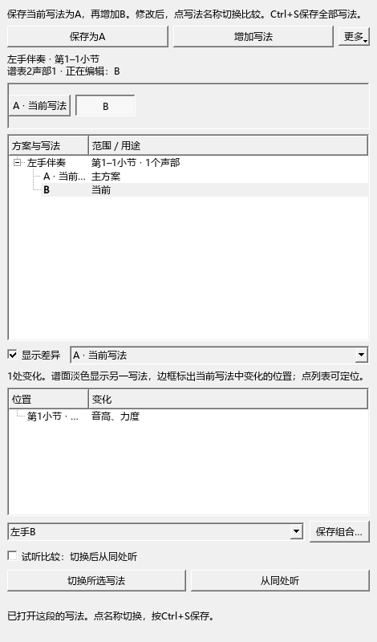
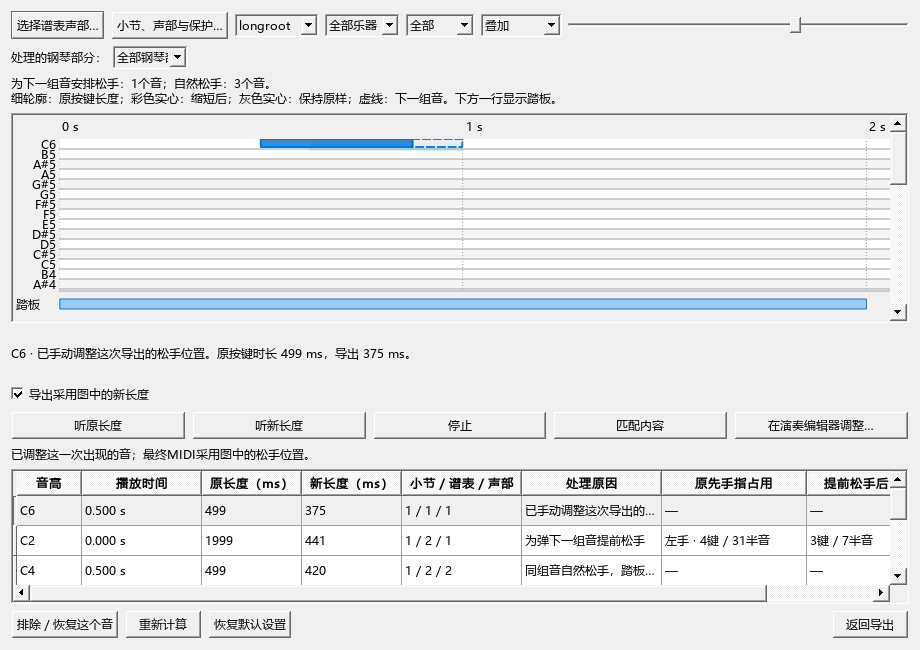
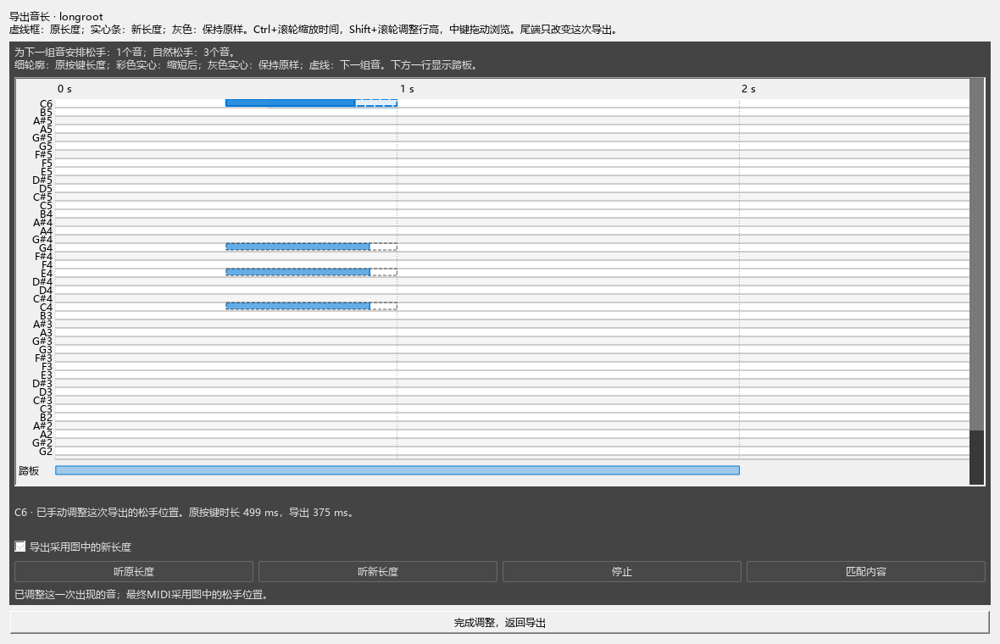

## 13. 分段试写：同一段保留A、B几种写法

例如，你想比较第9–12小节的左手，用稀疏和弦还是分解和弦。先保存A，再试写B，随时切回来听。

### 第一次建立A和B

1. 在谱面选中第9–12小节，打开“工具 → 分段试写方案”。
2. 点 **“保存为A”**，核对起止小节，勾选参加的谱表和声部。给这段起名，例如“副歌左手”。
3. 点 **“增加写法”**，输入“B · 分解和弦”。新写法立即打开；直接在谱面修改。
4. 在面板点A或B切换。也可点小节上方的按钮，从菜单选择写法。
5. 点 **“从同处听”** 比较当前写法。试听会包含进入这段所需的前文，用乐谱播放按钮或空格停止。
6. 按 `Ctrl+S` 保存MSCZ，以后打开继续切换。一次切换可用 `Ctrl+Z` 撤销。

面板写明范围、谱表、声部和“正在编辑”的写法。切换前自动记住刚才的修改。同一时间的其它声部、其它段落可以分别建立A/B。

### 同时看两种写法

勾选 **“显示差异”**，在旁边选择另一种写法。当前写法正常显示，另一写法以淡色叠在谱上；边框指出当前写法中有变化的位置。下方列表分别写出音高、节奏、增删音、力度及标记变化，点一行就定位到对应音。

例如，B的低音由C改为D并加强力度，选择与A比较后，谱上会同时看到当前D和淡色C；列表写着“音高、力度”。关掉“显示差异”即可专心编辑。

### 快速切换和保存组合

- 鼠标放在小节上方的写法按钮上，按 `Ctrl+滚轮` 切换。鼠标放在其它谱面位置时，仍按原来的操作缩放。
- 勾选 **“试听比较：切换后从同处听”**，每次切换后自动从这段的相同起点试听。关闭后，切换用于普通编辑。
- 先选好各段、各声部的写法，再点 **“保存组合…”**，例如保存为“稀疏伴奏＋旋律B”。从组合列表选择名称，所有相关组一起切换，`Ctrl+Z` 可一起恢复。
- 用相同名称保存会更新该组合。组合列表随当前选择更新；手动改成其它搭配后，列表显示“选择组合…”。

“更多 → 谱上显示切换按钮”控制谱面入口。关闭后可继续从面板切换，显示选择会自动记住。

### 连线和跨段内容

延音线和圆滑线随每种写法保存。延音线按同音和位置接回，圆滑线按原来所指的音接回；链接分谱会一起更新。改动了谱段外的连线端点时，面板指出小节和拍位，方便检查两边的位置。

滑音、连音组、跨谱表符杠等完整对象需要一起参加方案。建立时勾选相应声部；“更多 → 扩大范围”可以把前后小节加入各写法。各写法保持相同的总拍数、拍号和谱表结构。音符力度随写法保存，速度、踏板、调号及谱表力度记号由各写法共同使用。

### 直接保存和导出普通版副本有什么区别

**直接保存MSCZ就能保留全部写法和组合。** 每组通过“更多 → 设为主方案”指定普通MuseScore打开时看到的写法。普通版读取这些主方案组成的完整乐谱；本分支打开时恢复你上次正在编辑的组合。屏幕上的当前组合用于打印和常规导出。

**“更多 → 导出普通版副本”用于分享。** 可以选择当前组合或主方案，生成只含这份乐谱的文件。例如你正在比较B、希望发给别人看，就选当前组合导出。完整A/B文件继续在本分支中保存；普通软件重新保存文件时，附带的其它写法可能被丢弃。

旧“Arrangement Variants”插件保留完整谱副本方式。旧JSON工作区可继续打开，也可从“更多 → 导入旧写法”选取其中的谱段。

## 14. MIDI松手处理：让音长更接近实际弹奏

谱上写满的音可以借踏板继续发声，手指往往会提前松开去弹下一组音。MIDI松手处理调整导出文件里的按键长度，方便制作钢琴瀑布流视频。

### 第一次导出并比较

1. 文件 → 导出，选择MIDI。
2. 勾选 **“人性化裁剪：保守踏板模式”**，选择钢琴、小节范围和声部。
3. 在设置中选择是否保护旋律、最短按键时间、自然变化幅度和随机种子。
4. 点 **“查看对比”**，再点“匹配内容”，看清这一段音符。
5. 点一个音，下方会写出原按键时长、导出时长和松手原因。
6. 点 **“听原长度”／“听新长度”** 比较声音。两个按钮从当前拍位切换，播放光标与乐谱保持对应；“停止”停在当前位置。
7. 勾选 **“导出采用图中的新长度”**，点“返回导出”完成保存。“同时导出未裁剪版本”会额外生成原长度文件。

### 看懂对比图

- **细虚线轮廓：原按键长度。** 它的右边是原松手位置。
- **强调色实心条：拟采用的长度。** 实心条的右边是新松手位置。
- **灰色实心条：保持原样。** 详情会解释保留原因。
- **下方踏板轨：踩下至抬起的范围。** 选中音后，淡色区域显示可以调整的松手位置。
- **下一组音的虚线框：需要空出手来弹的音。** 详情会写出时间、音名以及自动安排前后的按键数量和跨度。

例如，左手C2在谱上写满一小节，踏板也保持着；后面要弹中区和弦时，可以先松开C2，再移动手去弹。图上保留C2的完整轮廓，并用实心条显示提前松手的位置，原因写为“为弹下一组音提前松手”。

### 放大、拖动和手动调整

“叠加”把原长度和新长度放在同一行；“上下分列”分开显示。用“全部／已缩短／保留”筛选音符。

- `Ctrl+滚轮`：以鼠标位置缩放时间。
- `Shift+滚轮`：调整音高行高度。
- 普通滚轮：上下浏览；中键拖动：移动视图。
- **“匹配内容”**：显示整段时间，保留可读的音高行；音域较宽时上下滚动查看。
- 拖实心条尾端：调整这个音在这一次导出中的松手点，按Esc取消当前拖动。
- 右键点音符：选择“恢复自动松手”或“保持原长度”。

拖动范围采用当前踏板、最短按键时间和保护设置。若把松手点拖到自动建议之后，详情会提醒检查下一组音的手位。反复出现的音分别显示，调整其中一次就只作用于这一次。

### 在演奏编辑器里看大图

点 **“在演奏编辑器调整…”**，打开可拉大、缩小的“演奏编辑器 · 导出音长”窗口。这里使用同一份音符、踏板、手动调整和试听结果。点“完成调整，返回导出”，回到原来的导出设置；原演奏编辑器恢复此前的显示。

### 自然松手、保护和保存

没有按键困难的音，采用“自然松手变化”：同一只手、同时弹下的一组音安排接近的松手时间，各音再加很小的差别。固定随机种子使相同谱子和参数重复导出得到相同结果。关闭随机可以比较确定的长度。

保留音会写明具体原因，例如跨越抬踏板、手工演奏事件、用户保护、连续踏板变化或长度太短。新音同时按下就跨度过大时，详情指出需要调整跨度、指法或分手。

处理参数会自动记住；手动松手点保留在本次打开的导出设置中。乐谱内容改变后，重新打开“查看对比”再安排松手。最终MIDI采用当前预览的参数和手动位置，谱面音长照常保留。试听需要已启用的声音设备和音源；也可以导出前后两个MIDI，在常用播放器中比较。
